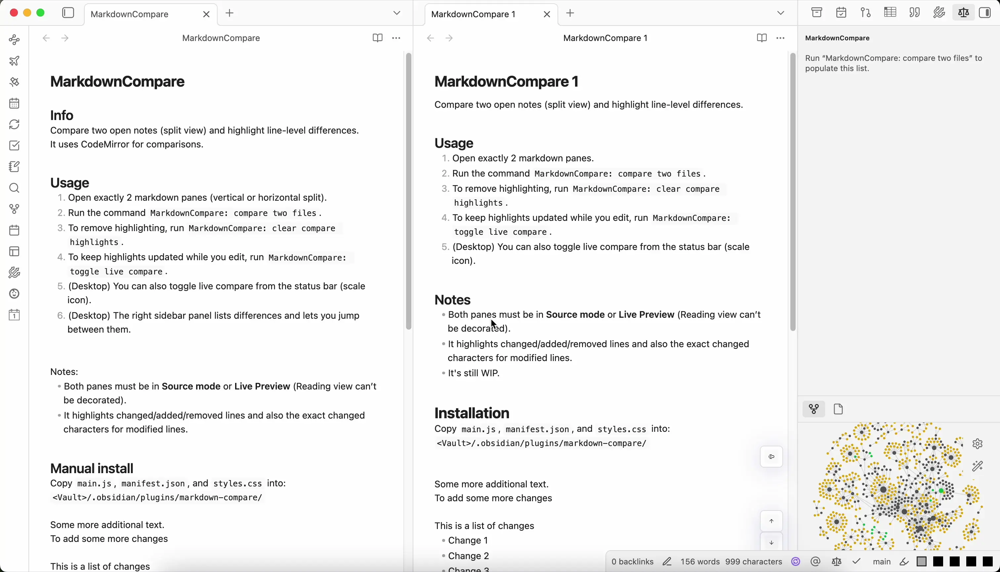

# MarkdownCompare

Compare two notes side by side, right in the editor. Changed lines and the exact changed characters are highlighted in both notes while you keep writing, sections are matched by their headings, and both notes scroll together.

## Start a comparison

- **Two notes open side by side:** run **MarkdownCompare: Compare two notes** from the command palette. They are compared straight away.
- **Any other layout:** the same command, or **Compare current note with…**, asks which note to compare the current one with. Notes open in tabs come first, then recently opened ones. A note that is not on screen opens in a split to the right.
- **From a menu:**
  - Right-click a note in the file explorer, a link or a search result, and choose **Compare with *current note***.
  - Right-click a tab and choose **Compare with…**.
  - Select two notes in the file explorer, right-click and choose **Compare the two notes**.

A comparison stays with its two tabs. You can open other notes, split panes or use the sidebars, and it keeps going. It ends when you close either tab, open another note in it, or run **Stop comparing**.

## What you see

- Lines only in the left note are red, lines only in the right note are green, and changed lines are yellow with the changed characters marked.
- Left and right are where the notes sit on screen (top and bottom in a horizontal split), so the colours stay the same wherever you click.
- Headings that appear in both notes anchor the comparison: text is only matched within the same section, and scrolling one note keeps the same section in view in the other.
- The **Markdown compare** panel in the right sidebar lists the differences under their headings. Click a difference to jump to it in both notes, or a file name to reveal the note in the file explorer.

## Live compare

**Toggle live compare**, or the scale icon in the status bar on desktop, keeps the highlights up to date while you edit either note. It stays on for later comparisons until you turn it off or run **Stop comparing**.

## Good to know

- Highlights show in Source mode and Live Preview. Reading view is not highlighted.
- The plugin never changes your notes. Highlights disappear when the comparison ends.
- It makes no network requests.

## Install

In Obsidian, open **Settings → Community plugins → Browse**, search for **MarkdownCompare**, install it and turn it on.

To install by hand, download `main.js`, `manifest.json` and `styles.css` from the [latest release](https://github.com/adalach/obsidian-markdown-compare/releases/latest) into `<vault>/.obsidian/plugins/markdown-compare/`, then turn the plugin on under **Settings → Community plugins**.
